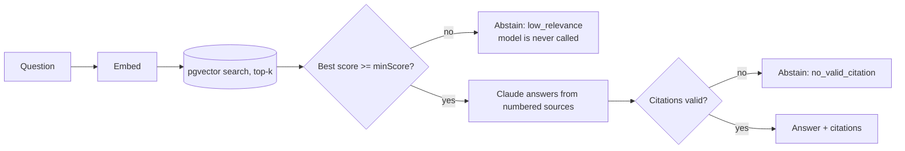

# cite-or-silence

**A RAG assistant that answers with verifiable citations, or stays silent.**

Most RAG demos answer everything, including questions the documentation never covers. This one treats "I don't know" as a feature: retrieval gates the model call, and a post-check rejects any answer whose citations do not map to the sources it was actually given.

Built with Next.js (App Router), TypeScript, Supabase (pgvector) and Claude.

## How it works



1. **Chunking** is heading-aware, so every citation points to a human-readable section.
2. **Retrieval gate**: if the best cosine similarity is below a threshold, the model is not called at all (cheaper, and it cannot hallucinate what it never saw).
3. **Grounded prompt**: the model only sees numbered sources and must cite them like `[1]`.
4. **Citation check**: an answer with no citation, or one citing a source number that was never provided, is discarded.

## Offline eval

`npm run eval` runs a retrieval eval with no API keys, so it also runs in CI as a regression gate.

| Metric | Result |
|---|---|
| hit@1 | 89% |
| hit@3 | 100% |
| MRR | 0.94 |
| Abstention accuracy (unanswerable questions) | 100% |
| False abstentions (answerable questions refused) | 0 |

The first run was worse: hit@1 was 78%. The two misses landed in the right file but the wrong section. Embedding the section heading together with the text, plus light stemming (`rotate` / `rotating`), raised hit@1 to 89% and widened the margin between answerable and unanswerable scores.

**Read these numbers honestly.** The eval uses a hashed bag-of-words embedder, a tiny corpus (3 docs) and 13 questions. It catches regressions in the pipeline logic; it does not measure real-world answer quality. The remaining miss ("How do I rotate an API key?" ranks the *API keys* section first) is a known limitation of lexical matching.

## Quick start

```bash
npm install
npm test          # unit tests + retrieval regression gate
npm run eval      # offline retrieval eval
npm run typecheck
```

To run it against real services:

1. Create a Supabase project and apply `supabase/migrations/0001_init.sql`.
2. Copy `.env.example` to `.env.local` and fill in the keys.
3. `npm run ingest` to embed the sample docs in `evals/corpus`, then `npm run dev`.

## Design decisions

- **`minScore` is required, with no default.** The right threshold depends on the embedding model. Calibrate it on your own eval set; the offline eval documents how it was calibrated for the hashed embedder.
- **Ports and adapters.** `Embedder`, `VectorStore` and `LLM` are small interfaces. Tests and evals use an in-memory store and a deterministic embedder; production uses OpenAI embeddings, Supabase and Claude.
- **Row Level Security is on** for the chunk table. Only the server-side service role reads or writes it.
- **The model call is the last resort**, not the first step.

## Status and limitations

- The Supabase store, the OpenAI embedder and the Claude adapter are type-checked but have **not been run against live services yet**. The pure logic (chunking, retrieval, abstention, citation checks) is covered by tests.
- No streaming, no auth on `/api/ask`, no rate limiting. This is a portfolio project, not a production service.
- Next: swap in real embeddings and re-calibrate `minScore`, add a faithfulness eval (does the cited text actually support the claim), and add streaming.

## Layout

```
src/lib/        chunking, embeddings, vector search, citations, prompt, ask()
app/            Next.js UI and /api/ask route handler
evals/          corpus, dataset and the offline eval
supabase/       pgvector migration with RLS
tests/          vitest suites
```
